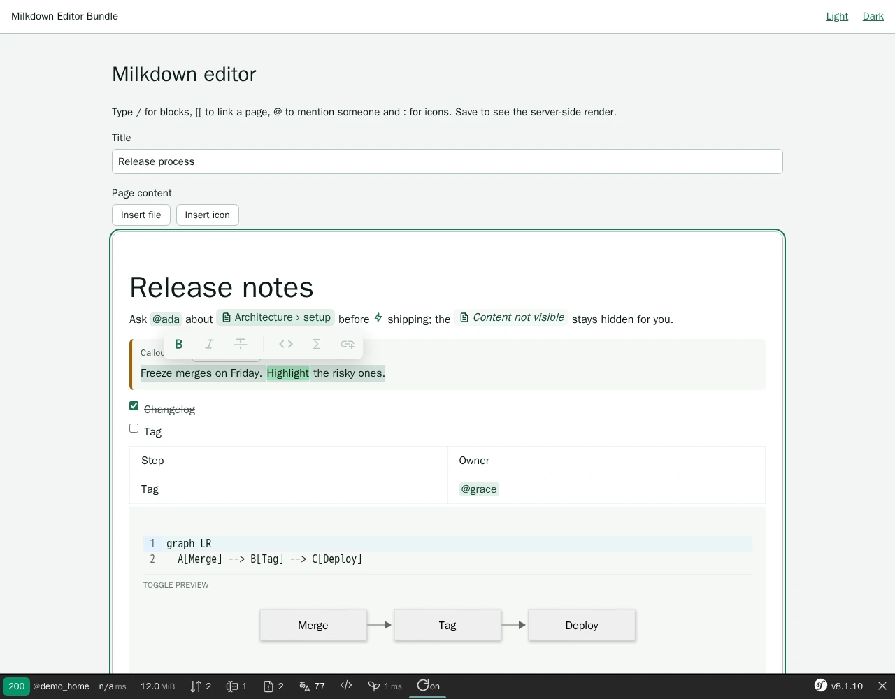
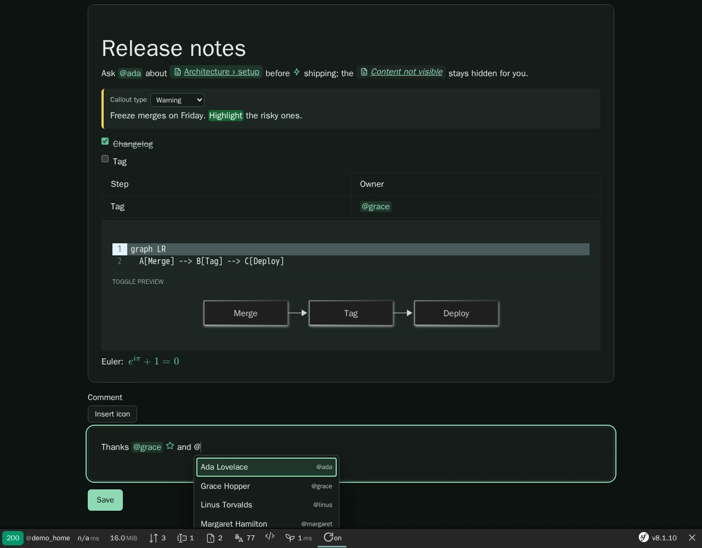

# Milkdown Editor Bundle

[](https://github.com/nowo-tech/MilkdownEditorBundle/actions/workflows/ci.yml) [](https://packagist.org/packages/nowo-tech/milkdown-editor-bundle) [](https://packagist.org/packages/nowo-tech/milkdown-editor-bundle) [](LICENSE) [](https://php.net) [](https://symfony.com) [](https://github.com/nowo-tech/MilkdownEditorBundle) [](#tests-and-coverage)

> ⭐ **Found this useful?** [Install from Packagist](https://packagist.org/packages/nowo-tech/milkdown-editor-bundle) · Give it a **star** on [GitHub](https://github.com/nowo-tech/MilkdownEditorBundle) so more developers can find it.

**Milkdown Editor Bundle** — a Symfony form type that edits **Markdown** with [Milkdown](https://milkdown.dev/) and a
reduced Crepe build, plus a league/commonmark renderer for the same Markdown dialect: page links by id resolved per
viewer, mentions, Tabler icons, callouts, collapsible sections, highlights, Mermaid diagrams and math. Markdown is
the stored value; the editor is accessible, works under a strict nonce-based CSP and loads code highlighting,
KaTeX, Mermaid and real-time collaboration only when a field needs them.

> 📋 **Compatible with Symfony 7.4+ and 8.0–8.1+** — PHP 8.2+ (Symfony 8.x requires PHP 8.4+).


This bundle is **FrankenPHP worker mode friendly**. See [docs/FRANKENPHP-WORKER-AUDIT.md](docs/FRANKENPHP-WORKER-AUDIT.md).

## Features

<table>
  <tr>
    <td align="center" width="50%">
      
      <br /><sub>Wiki profile — callout, tasks, table, Mermaid, math, selection toolbar</sub>
    </td>
    <td align="center" width="50%">
      
      <br /><sub>Dark theme — <code>@</code> suggestions with the ARIA listbox pattern</sub>
    </td>
  </tr>
</table>

- **`MilkdownEditorType`** — a textarea holding Markdown (the form value and the no-JavaScript fallback) turned into
  a Milkdown editor; named **profiles** (`features`, theme, icons, upload limits) and per-field options.
- **Reduced Crepe build** — toolbar, link tooltip, tables, CodeMirror code blocks, placeholder, cursor, an accessible
  `/` block menu, optional top bar; no list-item, image-block, block-handle, AI or emoji features.
- **Markdown dialect** (TypeScript and PHP): `[[wiki:<uuid>#anchor]]`, `@handle`, `:tabler-<name>:`,
  `:::callout{type=…}`, `:::details{summary=…}`, `::: {align=center}`, `:mark[text]{color=…}`, leaf directives such
  as `::beacon{type=issue id=…}` for host blocks, `$math$` / `$$…$$`, fenced `mermaid`.
- **Suggestions** — `[[` pages, `@` people, `:` icons and emoji, `/` blocks: remote candidate URLs, debounced, at most
  10 results, combobox keys (Up / Down, Enter / Tab, Escape) on the multi-line editable.
- **Per-viewer page titles** — chips resolve titles in one batched request; pages the viewer may not read show
  *Content not visible* (editor and renderer alike).
- **Uploads** — drop, paste or *Insert file*: multipart POST with the CSRF token in a header, progress and errors in a
  live region, size and type checks before sending.
- **Accessibility** — every control named, real `ul > li` lists and task checkboxes, contrast-safe tokens and code
  colours, visible focus rings, **Tab leaves the editor** outside lists, tables and code (WCAG 2.1.2).
- **Strict CSP** — no inline scripts or style elements without the nonce: CodeMirror and Mermaid styles get the page
  nonce; the widget adds its `<script type="module">` and stylesheet with it.
- **Opt-in extras** — Mermaid (strict security level, no HTML labels) and KaTeX (no `\href`), Yjs collaboration
  over Mercure (`collaboration` option), all in lazy chunks.
- **PHP renderer** — `milkdown_markdown` Twig filter / `MarkdownRendererInterface`: CommonMark + GFM + the dialect,
  raw HTML escaped, unsafe links dropped, remote images turned into links, host resolvers for pages, users, icons
  and directives.
- **Theme tokens** — `--nowo-milkdown-*` custom properties, light / dark / auto.
- **7 locales** (en, es, de, fr, it, nl, pt) in the `NowoMilkdownEditorBundle` domain.

## Installation

```bash
composer require nowo-tech/milkdown-editor-bundle
php bin/console assets:install
```

Without Symfony Flex, register `Nowo\MilkdownEditorBundle\NowoMilkdownEditorBundle::class => ['all' => true]` in
`config/bundles.php` (and `TwigExtraBundle`). Details: [docs/INSTALLATION.md](docs/INSTALLATION.md).

## Quick start

```php
use Nowo\MilkdownEditorBundle\Form\MilkdownEditorType;

$builder->add('body', MilkdownEditorType::class, [
    'profile'        => 'wiki',                                   // a profile from nowo_milkdown_editor.profiles
    'suggestions'    => ['[[' => '/api/pages', '@' => '/api/users'],
    'link_title_url' => '/api/pages/titles',
    'upload_url'     => '/api/upload',
    'upload_csrf_token' => $csrf->getToken('upload')->getValue(),
]);
```

```yaml
# config/packages/nowo_milkdown_editor.yaml
nowo_milkdown_editor:
    default_profile: wiki
    profiles:
        wiki:
            features: [toolbar, link_tooltip, table, code_mirror, math, mermaid, placeholder, cursor, slash_menu]
            icon_sprite_url: /icons/tabler-sprite.svg
            icons: [bug, bolt, rocket]
        comment:
            features: [toolbar, link_tooltip, placeholder]
```

```twig
{{ form_row(form.body) }}           {# the form theme is registered automatically #}
{{ page.body|milkdown_markdown }}   {# safe HTML of the same dialect #}
```

## Requirements

- PHP 8.2–8.5, Symfony 7.4 or 8.x (FrameworkBundle, Form, TwigBundle, Asset), Twig 3.21+ with Twig Extra
- league/commonmark 2.7+
- A browser with ES2022 modules (the editor is an ES module with lazy chunks)

### Version information

| Bundle | PHP | Symfony | Milkdown / Crepe |
|--------|-----|---------|------------------|
| 1.0.x | 8.2–8.5 | 7.4, 8.0, 8.1 | 7.23.0 |

## Demo

A Symfony 8.1 demo on FrankenPHP (worker mode) lives in `demo/symfony8`: both profiles, mock candidate endpoints, a
forbidden page, uploads, the server-side render and a strict nonce CSP.

```bash
make -C demo up        # http://localhost:8187
make test-e2e          # Playwright + axe + CSP
```

See [docs/DEMO-FRANKENPHP.md](docs/DEMO-FRANKENPHP.md).

## Documentation

- [Installation](docs/INSTALLATION.md)
- [Configuration](docs/CONFIGURATION.md)
- [Usage](docs/USAGE.md)
- [Contributing](docs/CONTRIBUTING.md)
- [Code of Conduct](CODE_OF_CONDUCT.md)
- [Changelog](docs/CHANGELOG.md)
- [Upgrading](docs/UPGRADING.md)
- [Release](docs/RELEASE.md)
- [Security](docs/SECURITY.md)
- [Engram](docs/ENGRAM.md)
- [Spec-driven development](docs/SPEC-DRIVEN-DEVELOPMENT.md)
- [GitHub Spec Kit](docs/SPEC-KIT.md)

### Additional documentation

- [Architecture](docs/ARCHITECTURE.md)
- [Standards compliance](docs/COMPLIANCE.md)
- [PSR evaluation](docs/PSR.md)
- [Coverage policy](docs/COVERAGE.md)
- [Demo FrankenPHP](docs/DEMO-FRANKENPHP.md)
- [FrankenPHP worker audit](docs/FRANKENPHP-WORKER-AUDIT.md)
- [GitHub CI](docs/GITHUB_CI.md)

## Tests and coverage

- Tests: PHPUnit (unit, integration), Vitest (TypeScript, jsdom with the real editor), Playwright + axe (demo e2e)
- PHP: 100%
- TS/JS: 90.66%
- Python: N/A

PHP line coverage target: **100%** of `src/` (gate **100%**, `make test-coverage-100`). TypeScript coverage is the
minimum of statements / branches / functions / lines (REQ-TEST-009); gate **≥ 90%** lines.

```bash
make test
make test-coverage
make test-ts
make test-e2e
make qa
```

## License

MIT © 2026 Héctor Franco Aceituno / Nowo.tech

## Contributing

See [docs/CONTRIBUTING.md](docs/CONTRIBUTING.md). Issues and pull requests: [GitHub](https://github.com/nowo-tech/MilkdownEditorBundle).

## Author

[Héctor Franco Aceituno](https://github.com/HecFranco) · [Nowo.tech](https://nowo.tech)
